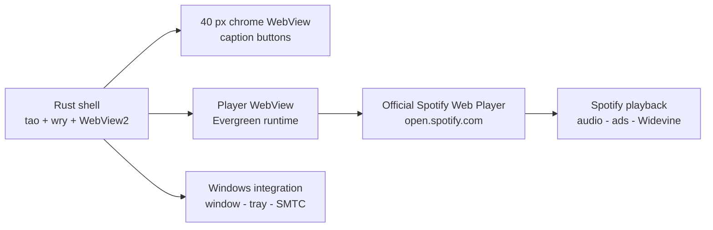

<h1 align="center">Rustify</h1>

<p align="center"><strong>A low-memory native Windows host for the official Spotify Web Player.</strong></p>

<p align="center">
  <a href="https://github.com/new-Sinote/Rustify/releases"></a>
  <a href="LICENSE"></a>
  <a href="#requirements"></a>
  
</p>

<p align="center">
  <a href="https://github.com/new-Sinote/Rustify/releases/tag/v0.2.0-pre.1"><strong>Download v0.2.0-pre.1</strong></a>
  ·
  <a href="docs/CERTIFICATION_0.2.0.md">Certification report</a>
  ·
  <a href="#build-from-source">Build from source</a>
</p>

---

Rustify loads `https://open.spotify.com/` inside a Rust-controlled WebView2 window. The official player keeps ownership of sign-in, playback, DRM, the queue, and advertising. Rustify supplies the Windows shell around it: a native window with Spotify-style caption buttons, tray behaviour, single-instance activation, window-state persistence, and a measured memory lifecycle.

It is an independent project, not a Spotify client. It is not affiliated with, endorsed by, or supported by Spotify AB.

## Download the pre-release

The current build is **[v0.2.0-pre.1](https://github.com/new-Sinote/Rustify/releases/tag/v0.2.0-pre.1)**.

- **Windows 10/11 x64** with the WebView2 Runtime.
- **Spotify account required.** Free accounts work; advertisements play normally.
- The installer is **unsigned**. Windows SmartScreen will warn on first run: choose **More info -> Run anyway**.
- Installs per-user, no administrator prompt. Uninstall from **Settings -> Apps**.
- [Release notes](docs/releases/v0.2.0-pre.1.md) and [certification report](docs/CERTIFICATION_0.2.0.md).

> **This is a pre-release, not a signed auto-updating product.** It carries the Phase 4 memory lifecycle and passed the playing, paused, CPU, and startup gates. Code signing and auto-update are not included.

## Status

| Phase | State |
|---|---|
| Phase 0-2 - feasibility, DRM, scope | Complete |
| Phase 3 - Windows DRM / background-playback spike | Complete; superseded by 0.2.0 |
| Phase 4 - performance research | Complete; [report published](docs/PERFORMANCE_RESEARCH.md) |
| V1 - production shell | Built; v0.2.0-pre.1 passed the release gates and is published |

## Which build should I use?

| Goal | Build | What you get |
|---|---|---|
| Try the app today | **v0.2.0-pre.1** | Low-memory lifecycle, custom caption bar, tray, SMTC, navigation allowlist, official playback. |
| Read the certification method and numbers | **v0.2.0-pre.1 report** | Soak, paused/hidden run, startup, and known limitations. |
| Inspect the Phase 4 baseline | **`bench/wryhost`** | The original measurement host: `Low`, `--memory-low`, `--toggle-file`, CDP. |
| See the old Tauri spike | **v0.1.0-pre.1** | Historical. No memory policy; do not judge 0.2.0 memory by it. |

## Performance

Measured PSS for the complete WebView2 process tree on one Windows 11 machine. Full method and per-process tables are in [docs/PERFORMANCE_RESEARCH.md](docs/PERFORMANCE_RESEARCH.md) and [docs/CERTIFICATION_0.2.0.md](docs/CERTIFICATION_0.2.0.md).

| Host | Paused | Playing | Notes |
|---|---:|---:|---|
| Official Spotify desktop client | 754.6 MB | 773.4 MB | CEF UI, native audio; not embeddable |
| Spotify Web Player in an Edge `--app` window | 754.2 MB | 732.7 MB | 12 processes; fails both budgets |
| Phase 3 Tauri spike - v0.1.0-pre.1 | 558.0 MB | 594.8 MB | No memory policy |
| **Rustify 0.2.0 - shipping shell** | 95.1 MB peak / 60.0 MB mean | 263.3 MB peak / 226.9 MB mean | `Low` lifecycle; 35-minute soak + hidden/paused run |
| Bare wry + WebView2 bench | 60.5 MB after re-trim | 206 MB after re-trim | The Phase 4 baseline |

`Low` is a one-shot trim request, not a cap. The shipping shell re-applies it after hydration, after a confirmed pause, every 120 seconds (including while paused), and after short track/ad gaps. The 35-minute soak samples the result every five minutes.

## Architecture



The shell never proxies Spotify traffic, rewrites the page, or touches the audio path. The only page modification is a scoped stylesheet that hides two nav-bar upsell elements; it is disclosed under [Scope and non-goals](#scope-and-non-goals).

## What works

| Area | State |
|---|---|
| Official web player | Runs unmodified apart from the scoped upsell CSS |
| Free accounts | Sign-in and playback verified |
| Advertisements | Play to completion; nothing blocks, skips, or mutes them |
| Widevine playback | Works on the tested Evergreen runtime; no probe or override in the shipping build |
| Background playback | Continues when the window is minimized or hidden |
| Tray | Show / Hide to tray / Reload / Open data folder / About / Quit; close button hides to tray |
| SMTC | Playback status and track metadata reported to Windows |
| Navigation allowlist | Top-level navigation limited to Spotify and the Cloudflare challenge |
| Custom chrome | Spotify-style minimize / maximize / restore / close; native resize edges |
| Window state | Size, position, and maximized state persist across launches |
| Single instance | A second launch activates the existing window |
| Nav-bar upsells | `Explore Premium` and `Install App` hidden by CSS |
| Memory policy | Hydration, pause, periodic, and post-gap `Low` trims |
| Auto-update | Not yet |
| Code signing | Not yet |

## Requirements

**To run the pre-release**

- Windows 10/11 x64
- Microsoft Edge WebView2 Runtime (Evergreen; already installed on current Windows builds)
- A Spotify account

**To build from source**

- Rust stable with the MSVC toolchain
- NSIS 3 (optional, for the installer)
- Node.js 20+ and npm only for the historical Tauri spike

## Install the pre-release

1. Open **[Releases](https://github.com/new-Sinote/Rustify/releases)** and download `Rustify-0.2.0-x64-setup.exe`.
2. Run the installer. It installs per-user; no administrator prompt is required.
3. Windows SmartScreen will warn because the binary is unsigned. Choose **More info -> Run anyway**.
4. Launch **Rustify** and sign in at `open.spotify.com`.

The app installs to `%LOCALAPPDATA%\Programs\Rustify`. The WebView2 profile lives in `%LOCALAPPDATA%\Rustify\WebView2`; the diagnostic log is `%LOCALAPPDATA%\Rustify\rustify.log`.

Uninstall from **Settings -> Apps -> Rustify**. The uninstaller asks whether to delete the local profile and settings; a silent uninstall keeps them. The old Phase 3 spike is a separate app (`Rustify Spike`); uninstall it if you no longer need it.

## Build from source

### Shipping shell

```powershell
cd app
cargo build --release
.\target\release\rustify.exe
```

The shipping binary has no CDP port, no `--url`, `--profile`, or `--log` flags, and no development tools. Those are compiled only with the `bench` feature used by the harness:

```powershell
cargo build --release --features bench
.\target\release\rustify.exe --cdp 9222
```

### Installer

```powershell
.\app\installer\build.ps1
```

The setup and `SHA256SUMS.txt` land in `app\dist\`. The script needs `makensis.exe` (NSIS 3+). It builds the per-user installer, creates Start Menu and desktop shortcuts, and registers the uninstaller under `HKCU`.

### Bench host - the Phase 4 baseline

```powershell
cd bench\wryhost
cargo build --release
.\target\release\wryhost.exe --url https://open.spotify.com/ --data-dir "$env:LOCALAPPDATA\RustifyBench"
```

Useful benchmark flags:

| Flag | Purpose |
|---|---|
| `--memory-low` | Set `MemoryUsageTargetLevel.Low` at launch |
| `--cdp <port>` | Enable the Chrome DevTools Protocol on `127.0.0.1:<port>` |
| `--toggle-file <path>` | Watch a file for `low` / `normal` and apply the memory level |
| `--browser-args "<args>"` | Pass additional Chromium/WebView2 arguments |
| `--hide-on-close` | Hide instead of exiting when the window is closed |
| `--hide-upsells` | Hide the nav-bar upgrade button and download link |
| `--custom-chrome` | Frameless window plus a second WebView title bar |

The last two are experiments in the benchmark host. The shipping app uses the same chrome and a scoped upsell rule as product defaults.

## Repository layout

```
app/                Shipping shell: wry + tao + WebView2, installer, assets.
  src/main.rs       Window, chrome, tray, allowlist, memory policy.
  installer/        NSIS per-user installer.
bench/
  wryhost/          Minimal wry + tao + WebView2 host. The Phase 4 baseline.
  tauri-shell/      Blank Tauri 2 shell used for the framework comparison.
  measure/          PowerShell and CDP measurement harness.
  results/          Sanitized per-sample memory data from the Phase 4 soaks.
spike/
  src-tauri/        Phase 3 Tauri 2 spike. Superseded; kept for the record.
  ui/               Unused local placeholder page required by the Tauri config.
docs/
  CERTIFICATION_0.2.0.md
  PERFORMANCE_RESEARCH.md
  PHASE-0-2-REPORT.md
  PHASE-3-SPIKE.md
  releases/         Release notes for published builds.
```

## Measurement harness

`bench/measure/` contains the scripts used for the reports:

- `tree-metrics.ps1` - PSS, working set, private commit, GPU memory, and CPU for a process tree.
- `cdp-metrics.mjs` - JS heap, DOM counters, and page state over the DevTools Protocol.
- `smtc.ps1` - Windows media-session status and position.
- `soak.ps1` - 35-minute playing soak with 5-minute samples.
- `hidden-soak.ps1` - 10-minute paused/hidden run at 1-minute samples.
- `cdp-chrome-check.mjs` - verifies the caption bar and the hidden upsell elements.
- `cdp-pause.mjs` - pauses the player before the hidden/paused run.
- `cdp-*.mjs` - navigation, playback, and click helpers for the benchmark page.

The scripts were written for the original test machine and contain `C:\Rustify\...` paths. Adjust those paths (or run from `C:\Rustify`) before using them elsewhere. They measure; they do not modify the Spotify page or the audio path.

## Privacy and data

- Rustify has **no telemetry**.
- The WebView2 profile lives in `%LOCALAPPDATA%\Rustify\WebView2`; the diagnostic log is `%LOCALAPPDATA%\Rustify\rustify.log`.
- Spotify receives the same web-player traffic it would receive in a browser. Nothing is proxied or re-streamed.
- Browser profiles, cookies, session storage, account screenshots, raw SMTC/soak logs, and track/playlist metadata are **not** published in this repository. `.gitignore` covers profiles, logs, screenshots, soak output, and build artifacts.

## Scope and non-goals

Rustify deliberately does **not**:

- block, skip, mute, filter, or alter advertisements;
- circumvent DRM, extract audio, or use alternative audio sources;
- extract credentials or session tokens;
- proxy, MITM, or rewrite Spotify traffic;
- use undocumented Spotify APIs or modified clients;
- inject general page scripts, extensions, or player modifications.

The one disclosed page change is a stylesheet that hides `Explore Premium` and `Install App` in the nav bar. It does not touch playback, ads, DRM, network traffic, or the player state.

The Phase 3 spike includes a documented one-shot DRM diagnostic probe. The shipping app does not. The benchmark host includes opt-in experiment flags. Neither is part of the measured shipping configuration.

Rustify is not affiliated with Spotify AB. "Spotify" and the Spotify logo are trademarks of Spotify AB. The MIT licence covers this repository's code, not Spotify's trademarks, content, or services. Using Rustify requires a Spotify account and remains subject to Spotify's terms.

## FAQ

**Is this V1?**  
It is the V1 pre-release. It carries the measured memory lifecycle, and the release gates passed: a 35-minute playing soak with a 263.3 MB maximum PSS and a 10-minute hidden/paused run with a 95.1 MB maximum, plus CPU and startup checks. Full method and numbers: [docs/CERTIFICATION_0.2.0.md](docs/CERTIFICATION_0.2.0.md). It is not code-signed and has no auto-update.

**Does it block ads?**  
No. Ads play normally, including on free accounts.

**Why does Task Manager show more than the PSS numbers?**  
Task Manager usually shows each process separately and its working set, which includes shared pages. The budget is PSS for the whole process tree, measured by `bench/measure/tree-metrics.ps1`. See the certification report for the per-sample numbers.

**Why does Windows warn about the installer?**  
The binary is unsigned. SmartScreen warns for unknown publishers. Verify the SHA-256 checksum attached to the release if you want to confirm the download.

**Why does memory run higher for the first minute?**  
The player is hydrating. The hydration trim is applied 30 seconds after page load, and WebView2 reclaims the memory asynchronously. The playing soak starts from the hydrated state, as in the Phase 4 method.

**Does it work on macOS or Linux?**  
No. It is Windows 10/11 x64 only.

**Can I use Spicetify with it?**  
No. Spicetify patches the installed Spotify desktop client's `xpui.spa` bundle. Rustify hosts `open.spotify.com` in WebView2; there is nothing to patch.

**Does it collect my data?**  
No telemetry. The local WebView2 profile stores your Spotify session, as a browser would. Spotify sees normal web-player traffic.

## Contributing

See **[CONTRIBUTING.md](CONTRIBUTING.md)**. Keep the official playback path intact, keep experiments behind benchmark flags, and do not submit ad-blocking, DRM-circumvention, or credential-handling changes.

## Licence

MIT. See **[LICENSE](LICENSE)**.
