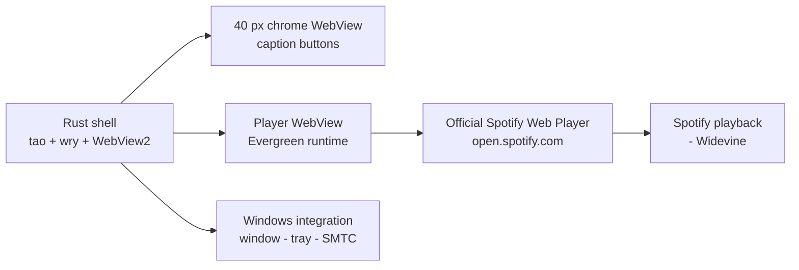

<p align="center">
  
</p>

<h1 align="center">Rustify</h1>

<p align="center">
  <strong>Spotify, without the browser tax.</strong><br>
  A native Windows shell In Rust for the official Spotify Web Player.
</p>

<p align="center">
  <a href="https://github.com/new-Sinote/Rustify/releases/latest"></a>
  <a href="LICENSE"></a>
  
  
</p>

<p align="center">
  <a href="https://github.com/new-Sinote/Rustify/releases/latest"></a>
  <a href="docs/CERTIFICATION_0.2.0.md"></a>
</p>

<p align="center">
  <sub>535 KB installer · Windows 10/11 x64 · free accounts welcome · no telemetry</sub>
</p>

> **Experimental uBOL build:** [v0.3.0-pre.1](https://github.com/new-Sinote/Rustify/releases/tag/v0.3.0-pre.1) bundles uBlock Origin Lite and is **not** the default download. It is not certified, Spotify audio ads may still play, and it carries extra Spotify ToS risk. [Release notes](docs/releases/v0.3.0-pre.1.md)

---

**Pause the music. Get the RAM back.** The 10-minute hidden/paused gate peaked at **95 MB** for the entire WebView2 process tree and averaged **60 MB**. The 35-minute playing soak peaked at **263 MB** and averaged **227 MB** — every sample well inside the 400 MB budget.

That is the point of Rustify. It is not another browser with a Spotify tab. It is a small, native Windows shell around the **official** player, with a memory lifecycle that actually returns memory when you stop listening.

No Electron bundle. No tab strip. No extension zoo in the default build. No telemetry. No account tricks.

## Why it is worth switching

These claims describe the default 0.2.0 build. The experimental uBOL build is covered separately below.

- **Pause and forget.** After a confirmed pause, Rustify cycles WebView2 back to its low-memory target. In the hidden 10-minute run: **95 MB peak, 60 MB average**. For comparison, Edge with a visible paused window measured **754 MB** on the same machine.
- **Native where it counts.** Spotify-style caption buttons, real resize edges, tray show/hide, close-to-tray, single-instance activation, remembered window position, and Windows media-session integration.
- **The official player, not a clone.** Sign-in, playback, DRM, the queue, and ads stay with `open.spotify.com`. Free accounts are verified; Premium accounts use the same official player.
- **Nothing hiding in the background.** No telemetry. No proxy. No token extraction. No bundled Chromium. No background updater. MIT source.

## The numbers

Measured as **PSS for the complete process tree** on one Windows 11 x64 machine. Lower is better. This is not Task Manager's per-process working set.

These are 0.2.0 numbers. The uBOL build has not been re-certified and may use more memory and CPU.

| Whole-tree PSS | **Rustify 0.2.0** | Spotify desktop | Spotify in Edge |
|---|---:|---:|---:|
| **Paused** (Rustify hidden) | **95.1 MB peak** / 60.0 MB average | 754.6 MB | 754.2 MB |
| **Playing, visible** | **263.3 MB peak** / 226.9 MB average | 773.4 MB | 732.7 MB |

Rustify's paused row is the hidden/tray gate; the desktop and Edge paused baselines were measured with visible windows. Hidden windows can release GPU memory, so the paused comparison is directional rather than an identical-state benchmark.

In these tests, Rustify's hidden paused footprint was about **one-eighth of Edge's visible paused footprint**, and its playing footprint was about **one-third of the desktop client's**. Both are full products with their own memory strategies; the comparison is about the same Spotify page, not about missing features. Rustify gets there with the player lifecycle, not by removing Spotify functionality.

The full per-sample data, method, and caveats are in the [0.2.0 certification report](docs/CERTIFICATION_0.2.0.md). The research behind it is in [Performance Research](docs/PERFORMANCE_RESEARCH.md).

## What you get

| Feature | What you get |
|---|---|
| **Player** | Official Spotify Web Player at `open.spotify.com` |
| **Accounts** | Free and Premium; free-tier sign-in and playback verified |
| **Audio** | Spotify playback and Widevine — untouched in the default build |
| **Window** | Spotify-style caption bar, native resize edges, DWM shadow |
| **Tray** | Show, hide, reload, open data folder, about, quit; close hides to tray |
| **Windows** | SMTC media session, single instance, saved size/position |
| **Network** | Spotify and the Cloudflare challenge only; popups and downloads blocked |
| **Privacy** | No telemetry, no proxy, no credential or token extraction |
| **Install** | 535 KB per-user installer; no administrator prompt |
| **Updates** | Manual for now; no auto-update |

The default build also hides the **Explore Premium** button and **Install App** link in the nav bar with one scoped stylesheet. That is its only page change. It is cosmetic, disclosed, and does not touch playback, ads, DRM, or network traffic. The uBOL build adds request filtering on top.

## Experimental uBOL build

`v0.3.0-pre.1` is a separate pre-release for people who want content filtering. It bundles unmodified **uBlock Origin Lite 2026.1124.1811** and loads it into the Spotify profile by default.

- Installer: `Rustify-0.3.0-x64-setup.exe`, 6.7 MB.
- Default uBOL rulesets are active; WebView2 has no extension popup or dashboard.
- Not re-certified. The 0.2.0 memory, CPU, and startup numbers do not apply.
- Spotify audio ads may still play. uBOL blocks many trackers and page requests, but it is not a guaranteed ad-free Spotify.
- Uses the same `%LOCALAPPDATA%\Rustify` profile. Reverting to 0.2.0 leaves uBOL registered in that profile but does not load it.
- uBOL is GPL-3.0, not MIT. The installer includes its licence and source information.

[Download v0.3.0-pre.1](https://github.com/new-Sinote/Rustify/releases/tag/v0.3.0-pre.1) · [Release notes](docs/releases/v0.3.0-pre.1.md) · [Research and caveats](docs/UBOL_INTEGRATION_RESEARCH.md)

## Install in about a minute

1. **[Download the latest release](https://github.com/new-Sinote/Rustify/releases/latest)** — `Rustify-0.2.0-x64-setup.exe`.
2. Run it. It installs per-user, with no administrator prompt.
3. Windows SmartScreen will warn because the installer is unsigned. Choose **More info → Run anyway**.
4. Launch **Rustify** and sign in at `open.spotify.com`.

**Requirements:** Windows 10/11 x64 (certified on Windows 11 x64), the Evergreen WebView2 Runtime (already present on current Windows builds), and a Spotify account.

**Uninstall:** Settings → Apps → Rustify. The uninstaller asks whether to delete your local profile; a silent uninstall keeps it.

> **Before you download:** Rustify is unsigned, has no auto-update, and is Windows-only. The default build plays ads normally; the uBOL build filters requests but may still play audio ads. If those are deal-breakers, this build is not for you yet.

## Proof, not promises

| Release gate | Target | Rustify 0.2.0 |
|---|---:|---|
| Paused PSS, 10-minute hidden run | ≤ 300 MB | **95.1 MB peak** |
| Playing PSS, every 5-minute soak sample | ≤ 400 MB | **263.3 MB peak** |
| Paused CPU | ≤ 1% of one core | **0.32% mean**; 0.24–0.39% sustained |
| Idle CPU | ≤ 0.5% of one core | **0.24–0.39%** sustained |
| Window ready | ≤ 500 ms | **272 ms** warm; 271 ms fresh profile |
| Installer | — | **534,512 bytes** |

One 10-second CPU sample touched 1.05%; two 60-second steady-state windows afterward measured 0.24% and 0.39%. The certification report keeps that transient visible rather than hiding it. The first launch on a machine where the WebView2 runtime had never been initialized once measured 652 ms; normal starts and fresh-profile starts measured 271–288 ms.

## How it works



In the default build, the shell never proxies Spotify traffic or touches the audio path. Apart from the disclosed nav-bar rule, the page runs as Spotify ships it. The uBOL build adds declarative request filtering through uBlock Origin Lite. `MemoryUsageTargetLevel.Low` is applied after hydration, after a confirmed pause, every 120 seconds, and after short track/ad gaps. The result is a player that behaves like a normal Windows app instead of a browser tab that never gives memory back.

## FAQ

**Is this an official Spotify app?**  
No. Rustify is an independent, unofficial host. It is not affiliated with, endorsed by, or supported by Spotify AB.

**Does it block ads?**  
The default 0.2.0 build does not. Ads are served by Spotify and play normally, including on free accounts.  
The experimental 0.3.0 uBOL build includes uBlock Origin Lite's default filtering. It blocks many trackers and page requests, but Spotify audio ads may still play, and ad behaviour is not guaranteed. It is not certified and carries 

**Will this get my account banned?**  
The default build does not alter playback, extract tokens, or use undocumented APIs. It hosts the official web player. The uBOL build does alter network requests, so treat its account risk as higher. Either way, Rustify is an unofficial client, so use remains subject to Spotify's terms.

**Why does Task Manager show more memory?**  
Task Manager usually shows each process separately and reports working set, which includes shared pages. The budgets use PSS across the whole process tree. See the [certification report](docs/CERTIFICATION_0.2.0.md) for the exact method.

**Does it work with a free account?**  
Yes. Free-account sign-in and playback were verified in the default build.; the uBOL build may filter some requests but may still play audio ads.

**Why is the installer unsigned?**  
Code signing is not set up yet, so SmartScreen warns about an unknown publisher. Verify the SHA-256 checksum attached to the release before running it.

**Does it work on macOS or Linux?**  
No. Windows 10/11 x64 only.

**Can I use Spicetify with it?**  
No. Spicetify patches the installed Spotify desktop client. Rustify hosts the web player; there is nothing to patch.

<details>
<summary><strong>Build from source, repository layout, and the benchmark harness</strong></summary>

### Shipping shell

```powershell
cd app
cargo build --release
.\target\release\rustify.exe
```

The default binary has no CDP port and no `--url`, `--profile`, `--log`, or test flags. Those are compiled only with the `bench` feature:

```powershell
cargo build --release --features bench
.\target\release\rustify.exe --cdp 9222
```

To build the experimental uBOL variant:

```powershell
cargo build --release --features ublock
```

It loads `extensions\ublock` next to the executable, or a folder supplied with `--ublock-ext` / `RUSTIFY_UBLOCK_EXT`.

### Installer

```powershell
.\app\installer\build.ps1
```

The script downloads and verifies uBOL 2026.1124.1811, builds with the `ublock` feature, and produces the 0.3.0 experimental installer. The setup and `SHA256SUMS.txt` land in `app\dist\`. It needs `makensis.exe` (NSIS 3+), creates Start Menu and desktop shortcuts, and registers the uninstaller under `HKCU`. Pass `-SkipUblockFetch` to reuse an already staged payload.

### Bench host

```powershell
cd bench\wryhost
cargo build --release
.\target\release\wryhost.exe --url https://open.spotify.com/ --data-dir "$env:LOCALAPPDATA\RustifyBench"
```

Useful benchmark flags: `--memory-low`, `--cdp <port>`, `--toggle-file <path>`, `--browser-args "<args>"`, `--hide-on-close`, `--hide-upsells`, and `--custom-chrome`.

### Repository layout

```text
app/                Shipping shell: wry + tao + WebView2, installer, assets.
  src/main.rs       Window, chrome, tray, allowlist, memory policy.
  installer/        NSIS per-user installer, uBOL fetch script and staged payload.
bench/
  wryhost/          Minimal wry + tao + WebView2 host. The Phase 4 baseline.
  tauri-shell/      Blank Tauri 2 shell used for the framework comparison.
  measure/          PowerShell and CDP measurement harness.
  results/          Sanitized per-sample memory data from the Phase 4 soaks.
spike/
  src-tauri/        Phase 3 Tauri 2 spike. Superseded; kept for the record.
docs/
  CERTIFICATION_0.2.0.md
  PERFORMANCE_RESEARCH.md
  UBOL_INTEGRATION_RESEARCH.md
  PHASE-0-2-REPORT.md
  PHASE-3-SPIKE.md
  releases/         Release notes for published builds, including v0.3.0-pre.1.
```

### Measurement harness

`bench/measure/` contains the scripts used for the reports:

- `tree-metrics.ps1` — PSS, working set, private commit, GPU memory, and CPU for a process tree.
- `cdp-metrics.mjs` — JS heap, DOM counters, and page state over the DevTools Protocol.
- `smtc.ps1` — Windows media-session status and position.
- `soak.ps1` — 35-minute playing soak with 5-minute samples.
- `hidden-soak.ps1` — 10-minute paused/hidden run with 1-minute samples.
- `cdp-chrome-check.mjs` — verifies the caption bar and the hidden upsell elements.
- `cdp-pause.mjs` — pauses the player before the hidden/paused run.

The scripts were written for the original test machine and contain `C:\Rustify\...` paths. Adjust those paths (or run from `C:\Rustify`) before using them elsewhere. They measure; they do not modify the Spotify page or audio path.

</details>

## Privacy and scope

- **No Rustify telemetry.** The app adds no analytics, crash uploads, or tracking. In the default build, Spotify sees the same web-player traffic it would see in a browser; the uBOL build filters some requests.
- **Local profile.** The WebView2 profile lives in `%LOCALAPPDATA%\Rustify\WebView2`; the diagnostic log is `%LOCALAPPDATA%\Rustify\rustify.log`.
- **Nothing extracted.** Rustify does not handle your password, extract session tokens, proxy traffic, or re-stream audio.
- **One cosmetic page rule in the default build.** A scoped stylesheet hides the two nav-bar upsells. It does not touch playback, DRM, or requests. The uBOL build adds request filtering.
- **Default build: Rustify is a host, not an ad blocker or a modified client. The experimental uBOL build is the disclosed exception.

Browser profiles, cookies, screenshots, raw soak/SMTC logs, and track or playlist metadata are excluded from this repository.

Rustify is not affiliated with Spotify AB. "Spotify" and the Spotify logo are trademarks of Spotify AB. The MIT licence covers this repository's code, not Spotify's trademarks, content, or services. Using Rustify requires a Spotify account and remains subject to Spotify's terms.

## Contributing

See **[CONTRIBUTING.md](CONTRIBUTING.md)**. Keep the default build's official playback path intact. Ad-blocking experiments belong behind the `ublock` feature and an experimental release, not the default installer. Do not submit DRM-circumvention or credential-handling changes.

## Licence

Rustify's own code is MIT. See **[LICENSE](LICENSE)**. The bundled uBOL payload in the experimental installer is GPL-3.0; its licence and source information are included with that build.
