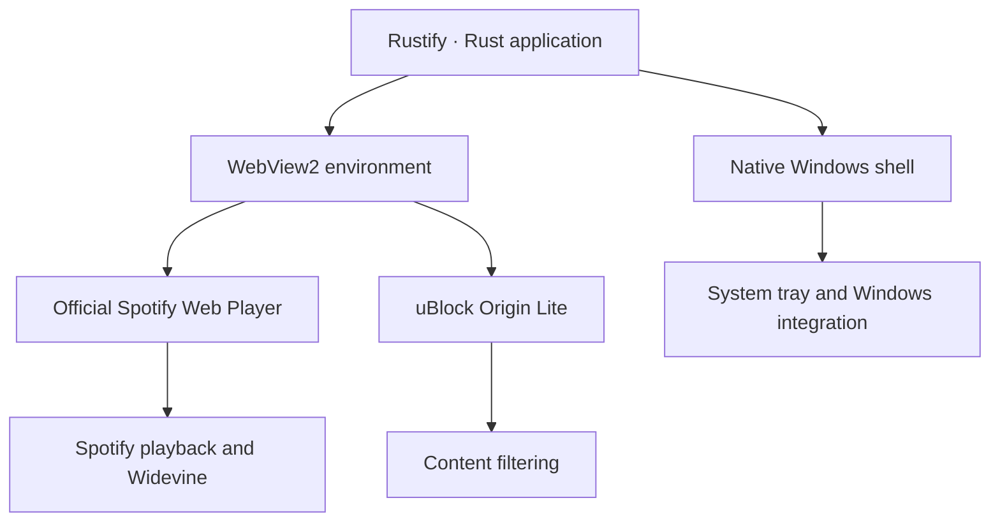

 <p align="center">
  
</p>

<h1 align="center">Rustify</h1>

<p align="center">
  <strong>Your music. Your desktop. Less overhead.</strong><br>
  A lightweight, native Windows desktop client for the official Spotify Web Player, built with Rust and WebView2.
</p>

<p align="center">
  <a href="https://github.com/new-Sinote/Rustify/releases/latest"></a>
  <a href="LICENSE"></a>
  
  
  
</p>

<p align="center">
  <a href="https://github.com/new-Sinote/Rustify/releases/latest"></a>
  <a href="https://www.scanrepo.dev/scan/github/new-Sinote/Rustify"></a>
</p>

<p align="center">
  <sub>Free to use · Open source · No telemetry · Windows 10/11 x64</sub>
</p>

---

## What is Rustify?

Rustify is an independent, lightweight Windows desktop application that wraps the **official Spotify Web Player** in a native Rust-powered shell.

It combines the familiarity of Spotify with native Windows integration and a memory-conscious WebView2 lifecycle.

And starting with **v0.3.0, Rustify includes uBlock Origin Lite**, bringing built-in content filtering directly into the application.

No Electron. No unnecessary browser interface. No telemetry. Just your music in a lightweight desktop environment.

## Highlights

- **Built-in content filtering:** Includes the official, unmodified uBlock Origin Lite extension with its default rulesets.
- **Lightweight:** Uses Microsoft's WebView2 runtime instead of bundling an entire Chromium browser.
- **Native Windows experience:** System tray, native window controls, resize edges, and Windows media-session integration.
- **Free and Premium support:** Uses Spotify's official web player, supporting both account types.
- **Privacy-conscious:** No Rustify analytics, telemetry, proxying, or credential extraction.
- **Open source:** Rustify's application code is licensed under MIT.

## Features

| Feature | Description |
|---|---|
| Spotify Web Player | Official `open.spotify.com` experience |
| uBlock Origin Lite | Bundled content filtering with default rulesets |
| Accounts | Spotify Free and Premium |
| Playback | Official Spotify playback and Widevine DRM |
| Native window | Custom title bar, resize edges, and DWM shadow |
| System tray | Show, hide, reload, and quit |
| Close to tray | Keep Rustify running in the background |
| Media integration | Windows System Media Transport Controls (SMTC) |
| Single instance | Prevents multiple application instances |
| Window persistence | Remembers window size and position |
| Privacy | No Rustify telemetry or analytics |
| Installation | Per-user installation without administrator privileges |

## Content filtering with uBlock Origin Lite

<sub>Introduced in v0.3.0</sub>

Rustify v0.3.0 bundles **uBlock Origin Lite (uBOL)**, the official, unmodified Chromium extension developed by Raymond Hill and contributors.

Unlike a separate browser extension installation, uBOL is bundled with Rustify and loaded automatically into its WebView2 environment.

### How it works

- The official uBOL extension is included with the application.
- Its default filtering rulesets are enabled.
- The extension is installed automatically alongside Rustify.
- No separate browser or extension installation is required.

### Important limitations

- Rustify does not guarantee a completely ad-free Spotify experience. Spotify audio advertisements may still play.
- WebView2 does not expose uBOL's normal extension popup, dashboard, or per-site settings interface.
- The bundled extension does not update independently. Updates require a new Rustify release.
- Content filtering changes network request behaviour. Spotify account and service policies still apply.

### Third-party licensing

uBlock Origin Lite is licensed under GPL-3.0. Its licence and source information are distributed with the installer.

Rustify's own application code remains MIT licensed.

## Performance

Rustify was designed around a simple idea: a paused music player shouldn't need to consume hundreds of megabytes indefinitely.

The following results were measured on a Windows 11 x64 test machine using **Proportional Set Size (PSS)** across the complete process tree.

<sub>These are v0.2.0 benchmark results, not v0.3.0 certification results.</sub>

| Measurement | Rustify 0.2.0 | Spotify Desktop | Spotify in Edge |
|---|---:|---:|---:|
| Paused, hidden peak | **95.1 MB** | 754.6 MB | 754.2 MB |
| Playing peak | **263.3 MB** | 773.4 MB | 732.7 MB |
| Paused average | **60.0 MB** | — | — |
| Playing average | **226.9 MB** | — | — |

### Additional v0.2.0 measurements

| Metric | Result |
|---|---:|
| Paused CPU average | 0.32% |
| Idle CPU | 0.24–0.39% |
| Warm window readiness | 272 ms |
| Fresh-profile readiness | 271 ms |
| Installer size | 534,512 bytes |

**A note on performance:** The benchmarks above apply exclusively to v0.2.0. The addition of uBlock Origin Lite in v0.3.0 changes the application's runtime behaviour, so these numbers should not be interpreted as measurements of the current release.

For the full methodology, test results, and limitations, see:

- [v0.2.0 Certification Report](docs/CERTIFICATION_0.2.0.md)
- [Performance Research](docs/PERFORMANCE_RESEARCH.md)

## Installation

### Requirements

- Windows 10 or Windows 11 (64-bit).
- Microsoft Edge WebView2 Evergreen Runtime.
- A Spotify account (Free or Premium).

### Getting started

1. Download the latest installer from [GitHub Releases](https://github.com/new-Sinote/Rustify/releases/latest).
2. Run `Rustify-0.3.0-x64-setup.exe`.
3. Complete the installation. Administrator privileges are not required.
4. Launch Rustify.
5. Sign in using your Spotify account.

uBlock Origin Lite is included and loaded automatically.

### Windows SmartScreen

Rustify is currently unsigned. Windows SmartScreen may display an unknown publisher warning.

You can verify the installer against the SHA-256 checksum published with the release before running it.

### Uninstallation

Navigate to:

`Settings → Apps → Installed apps → Rustify`

The uninstaller will ask whether you want to remove your local application profile and settings.

## How it works

Rustify uses a native Rust application shell built around `wry`, `tao`, and Microsoft's WebView2 runtime.



The application hosts Spotify's official web player rather than implementing its own playback engine.

uBlock Origin Lite provides declarative content filtering through the WebView2 extension environment.

Rustify does not proxy Spotify traffic, extract account credentials, or re-stream audio.

## Privacy and security

Privacy is an important part of Rustify's design.

- **No telemetry:** Rustify does not add analytics or usage tracking.
- **No credential extraction:** Login and authentication remain within Spotify's official web player.
- **No proxy:** Rustify does not route Spotify traffic through external servers.
- **No audio interception:** Playback remains within Spotify's official player.
- **Local profile:** Application data is stored locally on your Windows machine.

### Security scanning

Want to inspect the repository before installing?

<a href="https://www.scanrepo.dev/scan/github/new-Sinote/Rustify"></a>

[Open the Rustify ScanRepo report](https://www.scanrepo.dev/scan/github/new-Sinote/Rustify)

Security scanning results are provided by ScanRepo and should be considered alongside your own review of the source code and release artifacts.

## Frequently asked questions

**Is Rustify an official Spotify application?**

No. Rustify is an independent, unofficial application. It is not affiliated with, endorsed by, or supported by Spotify AB.

**Does Rustify support Spotify Free?**

Yes. Rustify uses the official Spotify Web Player and supports both Free and Premium accounts.

**Does Rustify include an ad blocker?**

Yes. Since v0.3.0, Rustify bundles the official uBlock Origin Lite extension. Its default filtering rulesets are enabled automatically.

However, this does not guarantee that all advertisements, particularly Spotify audio advertisements, will be blocked.

**Do I need to install uBlock Origin separately?**

No. uBlock Origin Lite is bundled with Rustify and installed automatically.

**Does uBlock Origin Lite have its settings interface?**

Not currently. WebView2 does not expose the extension's standard popup or dashboard interface in Rustify.

**Does Rustify collect my data?**

Rustify itself does not implement telemetry, analytics, or usage tracking. Spotify still processes the information associated with your Spotify account and use of its service.

**Will Rustify work on macOS or Linux?**

No. Rustify currently targets Windows 10/11 x64.

**Does Rustify support automatic updates?**

No. Updates are currently distributed manually through GitHub Releases.

**Can I use Spicetify with Rustify?**

No. Spicetify modifies the installed Spotify desktop application, whereas Rustify hosts the Spotify Web Player.

## Building from source

### Prerequisites

- Rust toolchain.
- Windows 10/11 x64.
- Microsoft WebView2 Evergreen Runtime.
- NSIS 3 or later (for installer generation).

### Build the application

```powershell
cd app
cargo build --release
```

### Build with uBlock Origin Lite

```powershell
cargo build --release --features ublock
```

The extension payload is loaded from `extensions\ublock` alongside the executable, or from a directory specified using `--ublock-ext` or `RUSTIFY_UBLOCK_EXT`.

### Build the benchmark configuration

```powershell
cargo build --release --features bench
```

### Build the installer

```powershell
.\app\installer\build.ps1
```

The installer build script downloads and verifies the pinned uBlock Origin Lite payload, builds the application, and generates the Windows installer and SHA-256 checksums.

For additional development information, see [CONTRIBUTING.md](CONTRIBUTING.md).

## Repository structure

```text
Rustify/
├── app/
│   ├── src/
│   │   └── main.rs
│   ├── installer/
│   └── assets/
├── bench/
│   ├── wryhost/
│   ├── tauri-shell/
│   ├── measure/
│   └── results/
├── docs/
│   ├── CERTIFICATION_0.2.0.md
│   ├── PERFORMANCE_RESEARCH.md
│   ├── UBOL_INTEGRATION_RESEARCH.md
│   └── releases/
├── spike/
├── LICENSE
├── CONTRIBUTING.md
└── README.md
```

## Contributing

Contributions, suggestions, and bug reports are welcome.

Before submitting changes, please read [CONTRIBUTING.md](CONTRIBUTING.md).

Rustify aims to remain lightweight, transparent, privacy-conscious, and open source.

## Licensing

Rustify's original application code is licensed under the **MIT License**.

The bundled uBlock Origin Lite extension is separately licensed under **GPL-3.0**. Its original licence and source information are included with the distribution.

See [LICENSE](LICENSE) for Rustify's licence.

---

<p align="center">
  <strong>Built with Rust. Made for Windows. Powered by Spotify.</strong>
</p>

<p align="center">
  <a href="https://github.com/new-Sinote/Rustify">GitHub Repository</a> ·
  <a href="https://github.com/new-Sinote/Rustify/releases">Releases</a> ·
  <a href="https://github.com/new-Sinote/Rustify/issues">Report an Issue</a> ·
  <a href="https://www.scanrepo.dev/scan/github/new-Sinote/Rustify">Security Scan</a>
</p>
