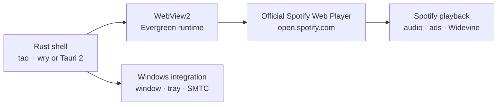

<h1 align="center">Rustify</h1>

<p align="center"><strong>A native Windows host for the official Spotify Web Player.</strong></p>

<p align="center">
  <a href="https://github.com/new-Sinote/Rustify/releases"></a>
  <a href="LICENSE"></a>
  <a href="#requirements"></a>
  
</p>

<p align="center">
  <a href="https://github.com/new-Sinote/Rustify/releases"><strong>Download the pre-release</strong></a>
  ·
  <a href="docs/PERFORMANCE_RESEARCH.md">Performance report</a>
  ·
  <a href="#build-from-source">Build from source</a>
</p>

---

Rustify loads `https://open.spotify.com/` inside a Rust-controlled WebView2 window. The official player keeps ownership of sign-in, playback, DRM, the queue, and advertising. Rustify supplies the Windows shell around it: a native window, tray behaviour, media-session integration, and a measured memory policy.

It is an independent research project, not a Spotify client. It is not affiliated with, endorsed by, or supported by Spotify AB.

## Download the pre-release

The first public binary is **[v0.1.0-pre.1](https://github.com/new-Sinote/Rustify/releases/tag/v0.1.0-pre.1)**, the Phase 3 Tauri spike, published as a GitHub pre-release.

- **Windows 10/11 x64** with the WebView2 Runtime.
- **Spotify account required.** Free accounts work; advertisements play normally.
- The installer is **unsigned**. Windows SmartScreen will warn on first run: choose **More info → Run anyway**.
- Installs per-user, no administrator prompt. Uninstall from **Settings → Apps**.
- [Release notes](docs/releases/v0.1.0-pre.1.md)

> **This is a research spike, not V1.** It proves login, Widevine playback, ads, tray behaviour, and SMTC. It does **not** include the Phase 4 memory policy. See [Which build should I use?](#which-build-should-i-use).

## Status

| Phase | State |
|---|---|
| Phase 0–2 — feasibility, DRM, scope | Complete |
| Phase 3 — Windows DRM / background-playback spike | Complete; pre-release installer available |
| Phase 4 — performance research | Complete; [report published](docs/PERFORMANCE_RESEARCH.md) |
| V1 — production shell | **Not built.** Gated on a periodic-trim soak and explicit approval |

## Which build should I use?

| Goal | Build | What you get |
|---|---|---|
| Try the app today | **Pre-release `setup.exe`** | Tray, close-to-tray, SMTC, navigation allowlist, official playback. No memory policy. |
| Inspect the measured memory behaviour | **`bench/wryhost`** | The Phase 4 baseline: `Low` trim, `--memory-low`, `--toggle-file`, CDP. |
| Evaluate V1 | **Not available** | The production policy is not certified yet. |

The pre-release is the Tauri spike. The measured baseline is the wry host. They share the same WebView2 engine but not the same memory policy.

## Why Rustify?

The official desktop client and an Edge app window both work, but both carry a full browser's overhead. Measured PSS for the complete process tree on one Windows 11 machine:

| Host | Paused | Playing | Notes |
|---|---:|---:|---|
| Official Spotify desktop client | 754.6 MB | 773.4 MB | CEF UI, native audio; not embeddable |
| Spotify Web Player in an Edge `--app` window | 754.2 MB | 732.7 MB | 12 processes; fails both budgets |
| Phase 3 Tauri spike — **the pre-release** | 558.0 MB | 594.8 MB | No memory policy applied |
| **Bare wry + WebView2, `Low` policy** | **60.5 MB** after re-trim | **206 MB** after re-trim; 319–430 MB in the one-shot soak | The measured baseline |

The 35-minute soak with a one-shot trim peaked at 429.8 MB at an ad boundary. The breach is an ad-creative/cache artifact, not a leak: the JS heap stayed at 58–73 MB and the DOM at 4.7–4.9k nodes. Re-applying `MemoryUsageTargetLevel.Low` on pause reclaimed 387.3 → 60.5 MB, and a mid-playback re-trim reclaimed 259.0 → 206.0 MB while the playhead advanced.

The method, per-process tables, observed ads, caveats, and the V1 gate are in **[docs/PERFORMANCE_RESEARCH.md](docs/PERFORMANCE_RESEARCH.md)**. The earlier feasibility, DRM, and background-playback work is in **[docs/PHASE-0-2-REPORT.md](docs/PHASE-0-2-REPORT.md)** and **[docs/PHASE-3-SPIKE.md](docs/PHASE-3-SPIKE.md)**.

## Architecture



The shell never proxies Spotify traffic, rewrites the page, or touches the audio path. The measured build runs the official page unmodified. The Phase 3 spike contains a documented one-shot DRM probe; the benchmark host has opt-in experiment flags. Both are outside the shipping path.

## What works

| Area | State |
|---|---|
| Official web player | Runs unmodified in WebView2 |
| Free accounts | Sign-in and playback verified |
| Advertisements | Play to completion; nothing blocks, skips, or mutes them |
| Widevine playback | Works on the tested Evergreen runtime; probed at startup |
| Background playback | Continues when the window is minimized or hidden |
| Tray | Show / Hide to tray / Quit; close button hides to tray |
| SMTC | Playback status and track metadata reported to Windows |
| Navigation allowlist | Top-level navigation limited to Spotify and the Cloudflare challenge |
| Remote capabilities | None; `withGlobalTauri=false` |
| Memory policy | Bench host only, not in the pre-release |
| Auto-update | Not yet |
| Code signing | Not yet |

## Requirements

**To run the pre-release**

- Windows 10/11 x64
- Microsoft Edge WebView2 Runtime (Evergreen; already installed on current Windows builds)
- A Spotify account

**To build from source**

- Rust stable with the MSVC toolchain
- Node.js 20+ and npm for the Tauri spike
- Git (optional, for cloning)

## Install the pre-release

1. Open **[Releases](https://github.com/new-Sinote/Rustify/releases)** and download `Rustify-Spike-0.1.0-x64-setup.exe`.
2. Run the installer. It installs per-user; no administrator prompt is required.
3. Windows SmartScreen will warn because the binary is unsigned. Choose **More info → Run anyway**.
4. Launch **Rustify Spike** and sign in at `open.spotify.com`.

The installer is built from [`spike/`](spike/) at tag `v0.1.0-pre.1`. The application version is `0.1.0`.

Uninstall from **Settings → Apps → Rustify Spike**. The WebView2 profile under `%LOCALAPPDATA%\com.rustify.spike` and the diagnostic log under `%LOCALAPPDATA%\RustifySpike` may remain; delete them manually if you want a clean profile.

## Build from source

### Bare wry host — the measured baseline

```powershell
cd bench\wryhost
cargo build --release
.\target\release\wryhost.exe --url https://open.spotify.com/ --data-dir "$env:LOCALAPPDATA\RustifyBench"
```

The host is a single small executable that uses the system WebView2 runtime. `--data-dir` is the **parent** of the `EBWebView` folder that WebView2 creates.

Useful benchmark flags:

| Flag | Purpose |
|---|---|
| `--memory-low` | Set `MemoryUsageTargetLevel.Low` at launch |
| `--cdp <port>` | Enable the Chrome DevTools Protocol on `127.0.0.1:<port>` |
| `--toggle-file <path>` | Watch a file for `low` / `normal` and apply the memory level |
| `--browser-args "<args>"` | Pass additional Chromium/WebView2 arguments |
| `--hide-on-close` | Hide instead of exiting when the window is closed |
| `--hide-upsells` | Benchmark-only: hide the nav-bar upgrade button and download link |
| `--custom-chrome` | Benchmark-only: frameless window plus a second WebView title bar |

The last two are experiments, not product defaults. The custom chrome adds a second renderer (~38.5 MB PSS); V1 should use a native-painted caption. The upsell flag is page injection and needs an explicit scope decision before it can ship.

### Tauri spike — the pre-release

```powershell
cd spike
npm install
npx tauri build --bundles nsis
```

The installer lands in `spike\src-tauri\target\release\bundle\nsis\`. The spike has no Tauri capabilities for the remote origin, a top-level navigation allowlist, a tray menu, and an SMTC poller. Its installer was 1.08 MiB in the Phase 3 run.

## Repository layout

```
bench/
  wryhost/          Minimal wry + tao + WebView2 host. The measured baseline.
  tauri-shell/      Blank Tauri 2 shell used for the framework comparison.
  measure/          PowerShell and CDP measurement harness.
  results/          Sanitized per-sample memory data from the Phase 4 soaks.
spike/
  src-tauri/        Phase 3 Tauri 2 spike: navigation allowlist, tray, SMTC.
  ui/               Unused local placeholder page required by the Tauri config.
  scripts/          Spike measurement script.
docs/
  PHASE-0-2-REPORT.md
  PHASE-3-SPIKE.md
  PERFORMANCE_RESEARCH.md
  releases/         Release notes for published builds.
```

## Measurement harness

`bench/measure/` contains the scripts used for the reports:

- `tree-metrics.ps1` — PSS, working set, private commit, GPU memory, and CPU for a process tree.
- `cdp-metrics.mjs` — JS heap, DOM counters, and page state over the DevTools Protocol.
- `smtc.ps1` — Windows media-session status and position.
- `policy-launch.ps1`, `soak.ps1`, `postsoak.ps1` — hydration, trim, 35-minute soak, and post-soak checks.
- `edge-launch.ps1`, `edge-measure.ps1` — Edge `--app` baseline.
- `cdp-*.mjs` — navigation and click helpers for the benchmark page.

The scripts were written for the original test machine and contain `C:\Rustify\...` paths. Adjust those paths (or run from `C:\Rustify`) before using them elsewhere. They measure; they do not modify the Spotify page or the audio path.

## Privacy and data

- The pre-release has **no telemetry**.
- The WebView2 profile lives in `%LOCALAPPDATA%\com.rustify.spike`. The diagnostic log lives in `%LOCALAPPDATA%\RustifySpike\spike.log`.
- Spotify receives the same web-player traffic it would receive in a browser. Nothing is proxied or re-streamed.
- Browser profiles, cookies, session storage, account screenshots, raw SMTC logs, and track/playlist metadata are **not** published in this repository. `bench/results/` contains sanitized per-sample memory data with page titles and playlist URLs removed.

## Scope and non-goals

Rustify deliberately does **not**:

- block, skip, mute, or filter advertisements;
- circumvent DRM, extract audio, or use alternative audio sources;
- extract credentials or session tokens;
- proxy, MITM, or rewrite Spotify traffic;
- use undocumented Spotify APIs or modified clients in the measured build;
- ship page injection or extensions as part of the product.

The Phase 3 spike includes a documented one-shot DRM diagnostic probe. The benchmark host includes an opt-in flag that hides two Spotify upsell elements. Neither is part of the measured shipping configuration, and neither changes playback or advertising.

Rustify is not affiliated with Spotify AB. “Spotify” and the Spotify logo are trademarks of Spotify AB. The MIT licence covers this repository's code, not Spotify's trademarks, content, or services. Using Rustify requires a Spotify account and remains subject to Spotify's terms.

## FAQ

**Is this V1?**  
No. It is the Phase 3 research spike. V1 is gated on a periodic-trim soak and approval.

**Does it block ads?**  
No. Ads play normally, including on free accounts.

**Why does Task Manager show more than 60 MB?**  
60.5 MB is the paused, post-trim PSS in the wry benchmark host. The pre-release is the Tauri spike without the memory policy; it measured 558.0 MB paused and 594.8 MB playing.

**Why does Windows warn about the installer?**  
The binary is unsigned. SmartScreen warns for unknown publishers. Verify the SHA-256 checksum attached to the release if you want to confirm the download.

**Does it work on macOS or Linux?**  
No. V1 is Windows 10/11 x64 only.

**Can I use Spicetify with it?**  
No. Spicetify patches the installed Spotify desktop client's `xpui.spa` bundle. Rustify hosts `open.spotify.com` in WebView2; there is nothing to patch.

**Does it collect my data?**  
No telemetry. The local WebView2 profile stores your Spotify session, as a browser would. Spotify sees normal web-player traffic.

## Contributing

See **[CONTRIBUTING.md](CONTRIBUTING.md)**. Keep the official playback path intact, keep experiments behind benchmark flags, and do not submit ad-blocking, DRM-circumvention, or credential-handling changes.

## Licence

MIT. See **[LICENSE](LICENSE)**.
